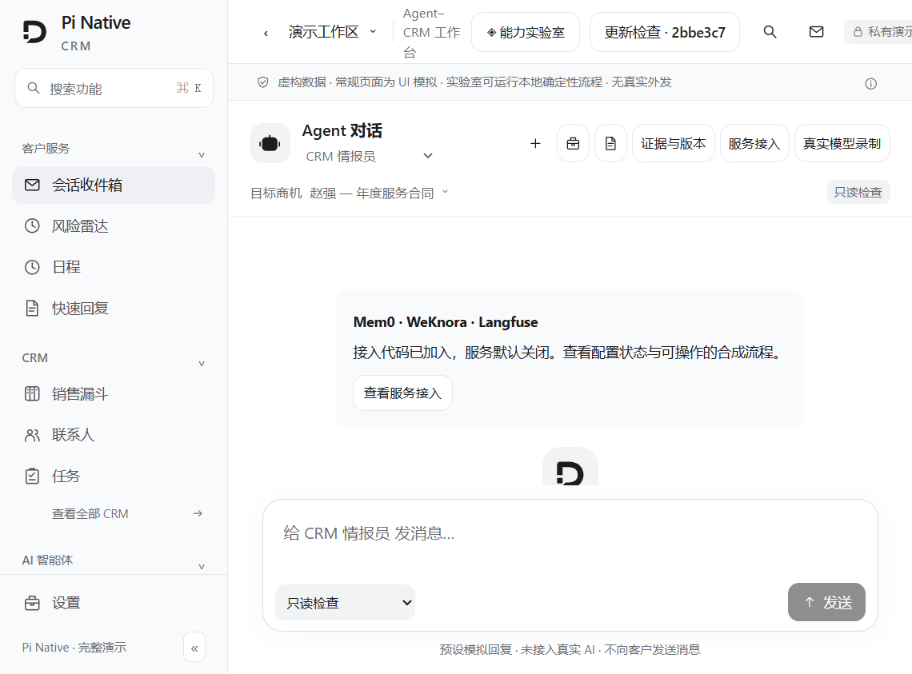

# Pi Native CRM

[中文](README.md) · **English**

**A self-hosted CRM workspace where AI agents work inside the real CRM — with controlled actions, human approval, run replay, and outcome evaluation.**

The source code contains these modules: *a sales-ops agent that investigates a stalled opportunity and can propose a reversible field change (approval required); an approval flow; run replay; and outcome evaluation* — plus the customer-conversation pipeline with its approval and audit steps. What is verified in this branch so far: the static preview below and the repository check suites ([onboarding report](docs/testing/2026-10-11-community-onboarding.md)). The full live pipeline (real Supabase/Redis, model calls, approvals, undo, replay, evaluation) has **not** been re-verified in this branch yet; no end-to-end success claim is made here. Approval and undo apply to the action types the code actually supports — not to any arbitrary CRM operation.

**Status (2026-10-11).** Community onboarding in progress. Verified so far in this branch: the static preview below (no keys), clean-clone install, the check suites, and the demo's clean-clone `npm ci`. The real backend is designed to run locally from this repository (setup below). Production self-hosting from this branch is **not yet verified** — see [ORIGIN.md](ORIGIN.md) and the [round-2 report](docs/testing/2026-10-11-community-onboarding-round2.md).

## 1-minute preview (no keys, no backend)

```bash
git clone https://github.com/Tong-bit-art/pi-native-crm.git
cd pi-native-crm
node scripts/serve-agent-demo.mjs
```

Open <http://127.0.0.1:3008/#/app/ai/workbench> — a static, synthetic CRM scenario plus sanitized **historical real-model recordings** (replay only; no model calls, and no data leaves the page).



The page labels what is simulated, what is a historical recording, and what belongs to a live local run. There is no hosted online demo yet.

## Real local backend (dev, ~60–90 min setup)

Requirements: Node.js 22+, pnpm, a development Supabase and Redis.

```bash
git clone https://github.com/Tong-bit-art/pi-native-crm.git
cd pi-native-crm
pnpm install --frozen-lockfile
```

Create the local config files (only if missing; existing files are kept as-is):

macOS / Linux:

```bash
test -e .env.local || cp .env.example .env.local
test -e .env || touch .env
```

Windows PowerShell:

```powershell
if (-not (Test-Path .env.local)) { Copy-Item .env.example .env.local }
if (-not (Test-Path .env)) { New-Item .env | Out-Null }
```

Fill in Supabase / Redis / app URL / server-side secrets following [docs/SETUP.md](docs/SETUP.md) (Portuguese; full configuration is the 60–90 min part). Then run, in separate terminals:

```bash
pnpm dev --port 3000     # web
pnpm worker              # agent execution
pnpm dev:crons           # local scheduler helpers
```

Open <http://localhost:3000/app/ai/workbench>, sign in, bind a real model credential in the organization settings, pick a built-in agent and a CRM object, and start a run.

These instructions come from the project's own setup guide; running the full live pipeline in this branch is still pending verification (scope and pending items: [round-2 report](docs/testing/2026-10-11-community-onboarding-round2.md)).

Mem0 / WeKnora / Langfuse are **optional** services, bound per organization; the core workbench does not depend on them. See [infra/local-agent-services/README.md](infra/local-agent-services/README.md) and [docs/integrations/agent-services.md](docs/integrations/agent-services.md).

## Production self-host — status

This branch has not yet completed its own release chain (images, versioning, installer). The `hostgator-setup-kit/` and `docs/deploy-selfhost/` in this tree come from the original project snapshot and still point at the upstream publishing channel. Do not treat this branch as "production out of the box" yet.

## Contributing

- Short English guide: [CONTRIBUTING.en.md](CONTRIBUTING.en.md)
- Full rules (Portuguese): [CONTRIBUTING.md](CONTRIBUTING.md)
- Provenance and branch status: [ORIGIN.md](ORIGIN.md)
- Docs index: [docs/index.md](docs/index.md)

## License

MIT — the original copyright notice is retained ([LICENSE](LICENSE)).
